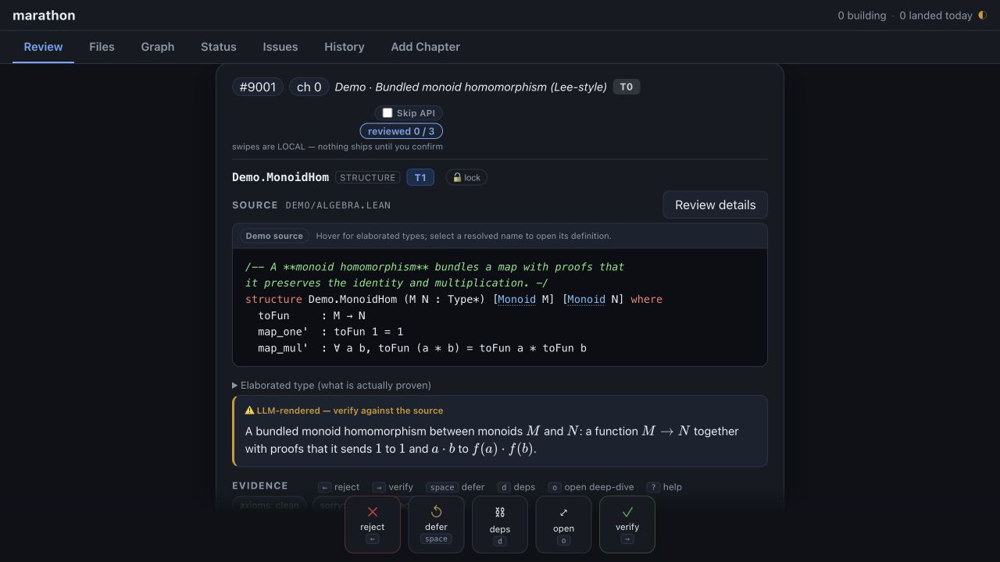

# Marathon v2

**Human review for machine-generated mathematics.**

[](LICENSE)
[](pyproject.toml)
[](https://github.com/Deicyde/marathon/releases/tag/v2.0.0)

Marathon explored how a mathematician could review and guide an automated Lean
formalization. It connected Aristotle's prover to a browser-based review
dashboard, local machine audits, and GitHub: inspect each declaration, check
its dependencies, and send precise feedback into the next iteration.

It was developed alongside the
[GeometricAnalysis](https://github.com/pitmonticone/GeometricAnalysis)
formalization of selected chapters of Lee's *Introduction to Smooth Manifolds*.

[Try the demo](#try-the-demo) · [Architecture](docs/architecture.md) ·
[Design history](docs/marathon-v2-plan.md) ·
[Download v2.0.0](https://github.com/Deicyde/marathon/releases/tag/v2.0.0)

## Historical release — November 6, 2026

This repository preserves the 2026 implementation as a research artifact.
[Aristotle no longer supports Lean-only projects](https://aristotle.harmonic.fun/docs/faq),
so the original automated proving and refinement loop cannot run against the
current service. The review UI, existing review records, local Lean builds,
and machine audits remain useful independently.

The historical SDK is pinned to `aristotlelib==2.0.0`. Upgrading the SDK alone
does not restore Lean support. The setup guides describe the original workflow.



*Declaration review in the self-contained demo. A real project can supply a
Verso build for semantic source rendering and definition lookup.*

## What's inside

- **Declaration review.** Review definitions and theorem statements individually;
  keep, reject with a note, or defer. Decisions are tied to the code reviewed.
- **Context for the mathematics.** Verso rendering, definition lookup, elaborated
  types, and whole-file or chapter views.
- **Dependency-aware navigation.** Explore the project graph and review
  prerequisites before the results that use them.
- **Machine evidence.** Local Lean elaboration, axiom and `sorry` accounting,
  statement dependencies, and checks for suspicious declaration patterns.
- **Durable orchestration.** Isolated worktrees, resumable prover sessions,
  retries, publication recovery, and GitHub issue and pull-request workflows.

Statement review and proof completion were tracked separately: a human-approved
statement could still contain `sorry`. The dashboard made that distinction visible.

## Try the demo

Requires Python 3.11+ and [uv](https://docs.astral.sh/uv/).

```bash
git clone https://github.com/Deicyde/marathon.git
cd marathon
uv sync --locked
uv run --locked marathon deck --demo --no-open --port 8765
```

Open **http://127.0.0.1:8765/**. The demo uses synthetic review cards and simulated
submissions; it needs no GitHub account, Aristotle key, or Lean project.

Use `←` to reject, `→` to verify, `space` to defer, and `?` for help. Opening an
issue starts a declaration-by-declaration review; file and graph views provide
the wider context in configured projects.

## The original workflow

1. **Generate and audit.** Produce Lean outlines, compile them locally, and
   collect evidence about their statements and dependencies.
2. **Review.** Compare informal mathematics with the Lean declarations. Record
   local decisions and submit an issue's outcome explicitly.
3. **Refine and repeat.** The conductor sends rejection notes to Aristotle,
   preserves work across iterations, and publishes changes through GitHub.

The conductor coordinated workers through project-local state, a SQLite ledger,
Git worktrees, and GitHub. Human review remained a separate step from the prover.

## Documentation

| Read | For |
| --- | --- |
| [Architecture](docs/architecture.md) | Module map, state ownership, and implementation invariants |
| [Collaborator setup](SETUP.md) | Configuring a project for the original review workflow |
| [Shared deployment](docs/shared-deck.md) | Hosting the dashboard behind GitHub authentication |
| [Claude Code plugin](plugins/README.md) | The CLI commands exposed as a plugin |
| [V2 design plan](docs/marathon-v2-plan.md) | Design goals and development phases |
| [Research and design reports](docs/v2-analysis/) | Investigations, alternatives, and critiques retained as history |

Use `uv run --locked marathon --help` to explore the preserved CLI.

## Development

```bash
uv sync --locked --extra dev
uv run --locked --extra dev pytest -q
```

The v2.0.0 release passed 1,914 regression tests. The demo and tests are useful
starting points for studying or adapting the harness without running a prover.
Consumer-project state, credentials, and textbook sources are not distributed here.

## License

[MIT](LICENSE) · Jack McCarthy, 2026.
